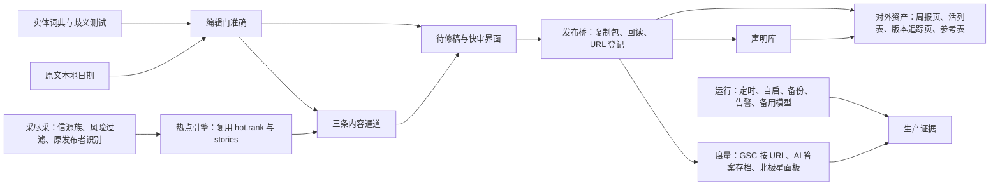

# AIHOT 开发 Brief v4（Goal 模式）：采尽采、蹭尽蹭，每个数字都对

> 日期：2026-11-06。作者：Claude（策划与验收）。执行：GPT（开发）、WorkBuddy 或云端（目标机）。决策：用户。
>
> 本文件取代 v3 计划和 GEO 计划里的执行顺序；两份文件里的问题清单、证据和单项设计仍然有效，按本文的依赖图重新排序。D1–D18 中与本文冲突的只有一条：审核产能从“每周 5–15 件、宁缺毋滥”改为“分通道、按分钟预算”（见 Phase 0 和 UI 一节），由用户在本次确认。
>
> 方法：先问“我最终想知道什么”，再问“什么事实能证明它”，最后才问“代码怎么实现”。

## 你最终想知道的

**AIHOT 值不值得。** 也就是：它能不能让齐普用很少的人力，持续把行业变化和热点变成网站上会被搜索和 AI 引用、能带来询盘的英文内容，而且不出错。

能证明它的事实只有这几类：已经发布并回读一致的 URL；每篇的人工处理分钟数；抽检出的错误数；这些 URL 在 GSC 里的展示和点击；固定问题集里 AI 回答对这些 URL 的引用；提到这些主题的询盘。代码只是产生这些事实的手段。

## Phase 0 — North Star：一句可以验真的话

> **到第 6 周，齐普每周发布并回读至少 5 个英文 URL（1 篇行业周报，内含至少 10 条快讯；至少 2 篇热点解读；至少 2 个技术或参考资产，可以是新写，也可以是更新），抽检 0 个数字或归属错误，运营每周处理总时长不超过 4 小时；从第 3 周起，这些 URL 在 GSC 的展示量逐周上升；第 6 周前，固定 20 问的 AI 回答里至少出现 1 次齐普 URL。**

| 指标 | 目标 | 证据来源 | 谁产生 |
|---|---|---|---|
| 发布 URL 数 | ≥5 个/周 | URL 登记表里状态为“已回读一致”的行 | 发布桥（M5） |
| 快讯条数 | ≥10 条/周 | 周报导出里的条目 | 快讯通道（M3） |
| 错误 | 0 | 每周 10% 随机抽检记录，加发布后更正记录 | 审核（M4） |
| 人工时间 | 快讯中位数 ≤2 分钟，热点 ≤15 分钟，资产 ≤45 分钟，合计 ≤4 小时/周 | 审核计时（打开到决定） | 审核界面（M4） |
| 搜索展示 | 第 3 周起逐周上升 | GSC 按 URL 导出，只统计 AIHOT 产出的 URL | 度量（M7） |
| AI 引用 | 第 6 周前 ≥1 次 | 固定 20 问的月度存档 | 度量（M7） |

目标值在第 2 周按实测校准一次，之后不再修改。

## Phase 1 — Truth Boundary：什么叫真，什么只能推断

| 级别 | 定义 | 可以怎么用 | 例子 |
|---|---|---|---|
| 事实 | 在绑定原文版本里逐字存在；自有实测有记录；系统可观测（回读结果、GSC 原始行） | 可以对外写，厂商数据仍要写明归属 | Kinglight 称 MC0606 封装 0.65 × 0.65 mm |
| 归属声明 | 某个主体说的性能、效果、预测 | 对外必须写 According to、据某某称 | 使用该器件的屏体最高 6,000 nits |
| 推断 | 模型的相关性判断、热度分、关键词假设、画像计数、Semrush 估算 | 只用于排序和内部决策，不进正文 | 热度 87、需求 3 条 |
| 未知 | 某一个具体字段缺失 | 写明哪个字段缺、怎么补、谁补；**禁止对整件事标 UNKNOWN** | 原发布日期未知，写“发现于 11 月 3 日” |

**功能“完成”的定义：** 在目标机上用真实数据看到运营能看到的行为，并且有截图和数据库记录。测试通过、文件同步都不算完成。

### 避开风险项（硬过滤，命中就不进自动通道）

1. 同行的负面消息（诉讼、事故、财务、裁员），以及对同行的评价和比较（D10）。
2. 涉及具体公司法律、财务、人事的未证实传闻。
3. 政治、制裁、关税立场类评论。官方政策事实可以进人工通道，不进快讯。
4. 灾难、伤亡、事故借势，包括屏体倒塌和火灾。
5. 未授权的客户名、项目和照片；付费墙和登录后内容；全文转载。
6. 认证、医疗、安全承诺类说法，除非有原文证据，并且只做归属陈述。

**除此之外：应采尽采，应蹭尽蹭。** 每蹭一个热点，必须留下一件资产：活列表里的一行，或者一个指向常青页面的链接（见 M6）。这条不是防御，而是让热度沉淀下来、可以复用。

## Phase 2 — Dependency Graph：依赖链，不是任务清单



- **关键路径：** E、D → G → R → P → M → X。北极星要靠度量才能证明，所以发布桥和度量必须尽早打通。
- **并行路径：** S → H → L，决定量能做到多大。
- **最大的杠杆：** AIHOT 框架本身就是热点引擎，已经有这些能力，只是没打开：
  - 热度排名每 5 分钟计算一次：48 小时窗口，每个独立信源只计一次，24 小时半衰期，并给出激增、新、上升三种标记。
  - 事件归组和相关报道关联。
  - 日报、周报、月报自动生成。
  - 告警和备份。

  “蹭热度”不需要新写系统，而是用 LED 的分类和提示词打开这条已有的管线，再把高热事件接到 Studio。

## Phase 3 — Minimum Evidence：最小可证明闭环

| 编号 | 主张 | 证据 | 证伪条件 |
|---|---|---|---|
| MEL-0（1 到 2 天） | MiP 解释文能从系统走到官网 | 稿件批准记录、导出 HTML、官网 URL、回读一致 | 导出日期不是 October 23；回读与批准版本有差异 |
| MEL-1（第 1 周） | 快讯通道能低成本出量 | 第 1 期周报上线，至少 10 条快讯，审核中位数 ≤2 分钟 | 中位数超过 2 分钟，或抽检出错 |
| MEL-2（第 2 周） | 能蹭热点 | 一篇热点解读在激增标记出现后 48 小时内上线，并留下一行活列表 | 超过 48 小时；热度来自同一新闻稿的转载 |
| MEL-3（第 3 周） | 能证明效果 | GSC 按 URL 导入，北极星面板显示第 1、2 周 URL 的真实行（展示为 0 也照实显示） | 面板数字和 GSC 原始导出对不上 |

每个闭环先做最小版本。在用真实数据证明之前，不加任何功能。

## Phase 4 — Adversarial Review：它怎么会骗我

每次完成后不问“能跑吗”，而是逐条回答下面的问题，并附上反证测试。

1. **合成数据骗过真实格式。** 真实标题写的是“V9.7”，测试里写的是“v9.7”。所有采集、日期和版本逻辑，都必须用真实存档样本回放。
2. **零结果冒充判断正确。** 没出卡可能只是没看见。每类规则都要有应出、不应出的正向对照。
3. **简称太宽，造成错误归属。** “灰度”同时是 LED 术语（灰度等级），“聚积”是普通动词，“巨能”也可能是普通词。每个新简称都要在 217 条素材语料里跑一遍歧义测试；会命中普通用法的，只能用带上下文的写法（例如“灰度科技”）。**勘误：** GEO 计划 PR-1 的候选名单里，“灰度”和“聚积”不能作为单独简称使用。
4. **热度被转载放大或被聚合源压扁。** 同一篇新闻稿出现在 20 个网站上，不等于 20 个独立信源；反过来，Google News RSS 把很多发布者装进同一个信源，会把热度压扁。聚合源的条目必须解析出原发布者和原文 URL，再计入热度。
5. **页面对了，导出还是错的。** 日期在界面上改对了，导出里仍是 UTC。必须扫描导出文件。
6. **批准的版本和网站上的版本不一样。** WordPress 里被人改过。只有回读一致，才算发布。
7. **审核时间被“秒过”美化。** 每周随机抽检 10% 已批准的快讯，并统计发布后的更正。
8. **展示上升不是因为内容。** 只统计 AIHOT 产出的 URL，把品牌词和首页排除在外。
9. **AI 引用被挑问题美化。** 固定 20 问先冻结，之后不再改动。
10. **“已同步”冒充“已运行”。** 目标机必须返回运行版本号，以它为准，不以文件同步为准。

## Phase 5 — Invariants + Gates：不可回退的规则

每条都必须有自动测试。CI 失败就不能合并。

1. 对外的每个数字都有归属，并且能回到原文的逐字引用；BLOCK 不能放行。
2. 对外日期使用原文所在时区的日历日期；任何导出里都不能出现 ISO UTC 时间串。
3. 公开英文字段零汉字；中文只出现在社媒和视频字段。
4. 命中风险清单的内容不进入自动通道。
5. 首次导入的条目不产生快讯，也不产生版本卡。
6. 模型只在人工点击或预算内的批量任务里调用，每次调用都有回执；预算用尽就停。
7. URL 回读一致后才计入“已发布”。
8. 新增简称必须通过歧义测试。
9. 运营界面不出现内部编码，由 scripts/check-operator-copy.ts 扫描。
10. 聚合源的条目必须带原发布者和原文 URL，否则不参与热度计算。
11. 迁移每个文件一条语句（AGENTS.md）；全量测试在 Node 24 上通过。

## Phase 6 — Production Evidence：最后才谈上线完成

**以下条件全部满足，才算“上线完成”：**

- 在目标机上连续 2 周达到北极星指标。
- 定时采集和热点引擎在运行，备份做过一次恢复演练。
- 告警真实触发过一次并被处理；备用模型渠道演练过一次。
- 每个已发布 URL 的成本可以估算（供应商 usage × 列表价，标为估算）。
- 北极星面板的数字能逐条对上原始数据。

## 核心功能架构

| 模块 | 作用 | 复用现有 | 需要新做 | 依赖 |
|---|---|---|---|---|
| M0 信任核心 | 把事实写对 | 编辑门、证据绑定、版本批准 | 实体词典补全与歧义测试；本地日期；把命中项归并成不超过 5 个“需要你判断的问题”（只用于界面展示，不是放行条件）；待修稿编辑 | 无 |
| M1 采尽采 | 把量做大 | rss、web_list、信源预览、首次导入基线 | 信源族（见下）；风险过滤；聚合源的原发布者和原文 URL 解析 | M0 |
| M2 热点引擎 | 知道什么正在热 | hot.rank、hot.snapshot、stories、events、reports | LED 化的配置；把高热事件接成 Studio 的热点卡，带 48 小时截止时间 | M1 |
| M3 三条通道 | 不同的量配不同的审核成本 | 现有成稿与审核链路 | 快讯模板（80 到 150 词，谁、什么、何时、来源，加一句对采购的影响）；热点解读模板（600 到 1000 词，热点＋常青知识）；资产模板（解释文、教程、参考表、旧页更新） | M0、M2 |
| M4 快审界面 | 让人力只花在需要判断的地方 | Studio 页面组件 | “今日”页、专注快审、左右对照审核（见 UI 一节） | M0、M3 |
| M5 发布桥 | 从批准到上线再到回读 | 导出 | 复制包（标题、slug、meta、HTML、内链建议、图片 alt）；填入 URL 后回读比对；URL 登记 | M4 |
| M6 对外资产 | 把热度和变化沉淀成会被引用的页面 | 周报生成 | 行业周报页；活列表（全球大型 LED 屏、展会日历）；版本追踪页；参数登记表 | M5，声明库 |
| M7 度量 | 证明北极星 | 搜索信号导入 | GSC 按 URL 导入；AI 答案存档导入；北极星面板 | M5 |
| M8 运行 | 无人值守 | worker、告警、备份 | 目标机开机自启（数据库 → 迁移 → 应用）；恢复演练；备用模型；成本估算 | 无 |

### M1 信源族（采尽采的具体做法）

所有信源都必须是公开来源，不登录、不绕过限制，默认只存摘要和原文链接。

1. **新闻聚合查询 RSS**：Google News 和 Bing News 的关键词 RSS，例如 LED display、LED screen、LED billboard、video wall、jumbotron、MicroLED、direct view LED、DOOH、digital billboard、stadium screen，再加每个上游主体的名字。
2. **行业媒体 RSS**：Sixteen:Nine、rAVe、Digital Signage Today、Commercial Integrator、InAVate、LEDinside、TrendForce、AVNetwork、Billboard Insider 等（逐个预览后启用）。
3. **新闻稿通道**：PR Newswire、Business Wire、GlobeNewswire 的显示和电子类分类 RSS。
4. **原厂渠道**：现有原厂新闻和下载页，以及原厂 YouTube 频道的 RSS。
5. **社区**：Reddit 的 r/DigitalSignage、r/VIDEOENGINEERING、r/LEDs 等的 RSS，只用来发现问题，不引用原帖。
6. **日历**：CES、ISE、InfoComm、LED CHINA、ISA Sign Expo、大型体育赛事、纽约时代广场跨年等，每年录入一次。

### 蹭热度的落点（SEO 有效，不变成垃圾页）

**量放在周报和活列表里，单独成页只给有角度的内容。** Google 的垃圾政策针对的是“规模化低价值内容”。因此：

- **快讯**只进周报页，不单独成页。
- **热点解读**必须写出常青角度：尺寸、像素间距、亮度、造价、原理，并链接到已有页面。
- **每个热点**都在活列表里留下一行。比如“全球大型 LED 屏”这一页，正是 Linsn 和 EagerLED 拿流量的题材类型，而它需要持续更新，正好由热点引擎来喂。

## UI 与 UX：怎么分配运营的注意力

可点击原型见 `docs/prototype/studio-today.html`，GPT 按它实现。

### 原则

1. **用时间预算代替“待办数量”。** 顶部写“今天预计 32 分钟”，每一项都标预计分钟数。
2. **按“会不会过期、值不值钱”排序。** 第一组是阻断（最多 3 条，红色）；第二组是热点窗口（带倒计时）；第三组是快讯快审（批量处理）；第四组是深度稿和资产（按日程）。
3. **只高亮有风险的东西。** 数字和名称是风险所在，所以只高亮它们。已自动核对的项目折叠起来，只显示一个计数（例如“已自动核对 41 项”）。
4. **把提示变成问题。** 不显示“45 处 WARN”，而是显示“需要你判断的 3 件事”，用普通中文问，每个问题旁边就是原文引用。
5. **每张卡只有一个主按钮。** 默认动作就是正确动作；拒绝理由提供预设选项。
6. **键盘和手机都能快审。** J 和 K 切换上一条、下一条；A 通过，E 修改，X 不要（数字键选理由）。390 宽度也能完成快讯审核。
7. **给完成感。** 全部处理完显示“今天的任务完成了”，以及本周北极星进度。

### 页面

- **今日**：四组队列加右侧北极星栏，包括本周已发布 URL 与目标、审核分钟、展示趋势、AI 引用。
- **审核**：左边是稿件，数字和名称高亮；右边是原文，自动滚动到对应句子。顶部是“需要你判断的事”，下方是可以直接编辑的正文，改完立即重新检查。
- **热点雷达**：话题、48 小时热度曲线、标记、独立发布者数、匹配的问题、建议角度，以及一个“蹭这个”按钮（生成热点卡，48 小时截止）。
- **发布助手**：一键复制标题、slug、meta、HTML、内链建议；填入官网 URL 后回读，显示“一致”或“差异”。
- **周报编排**：拖动排序，自动生成导语，导出。

### 文案规则

- **不用内部编码：** 界面上不出现 A–E、D1、W4、drafts[0]、UTC 时间串和任务 UUID。
- **日期写法：** 写“10 月 23 日（北京时间）”。
- **未知怎么说：** 只说缺哪一项，以及点哪里去补。

## 迭代节奏（敏捷，每周一个可演示结果）

| 周 | 沿依赖图推进到 | 演示 |
|---|---|---|
| S0（1 到 2 天） | E 的最小版本（只加“晶台”）、导出日期、复制包 | MEL-0：MiP 文章上线并回读 |
| S1 | M0 补全、M3 快讯通道、M4 今日页与快审、M5 回读 | MEL-1：第 1 期周报上线 |
| S2 | M1 信源族、风险过滤、原发布者解析；为 LED 打开 M2 热点引擎；热点雷达与热点通道 | MEL-2：48 小时内蹭上一次热点 |
| S3 | M6 活列表、版本追踪页、周报编排；M7 GSC 导入与北极星面板 | MEL-3：面板显示真实数字 |
| S4 | M8 运行加固；声明库 v1；AI 答案存档导入 | 7 天无人值守 |
| S5–S6 | 只修数据暴露的问题 | Phase 6 生产证据 |

旧计划的对应关系：GEO 计划的 PR-1、PR-2、PR-3 对应 S0 和 S1；PR-4 对应 S3；PR-5、PR-6 对应 S4。v3 的 R2、R3 分别并入 S3 和 S4。Issue #12 只保留“信源用途字段”加风险过滤，在 S2 完成。

## 给 GPT 的工作方式（反防御）

### 你自己决定，不用问

代码、测试、界面文案、模板、重构；在风险清单和访问规则以内新增公开信源，并先预览；用真实存档做回放；修复你发现的问题；取舍方案时选最小可证明的那个，用一句话写明理由。

### 必须先问用户

- 合并 PR（用户可以一次性授权“Claude 验收通过即可合并”）。
- 在目标机打开运行开关，或改变模型预算。
- 对外发布。
- 简称名单中有歧义的项。
- 风险清单的增删。

### 不要做

- 写 ZIP 或 Drive 交接包、A2A JSON、marker；每条消息都复述约束；把整件事标为 UNKNOWN 或 HOLD。
- 在测试通过后宣布“完成”；为了让测试变绿而删除断言；自动发布；放行 BLOCK。

### 回执格式（每回合不超过 12 行）

1. 做了什么（一句话）。
2. 推进到依赖图的哪个节点。
3. 证据：链接或截图路径。
4. 北极星的变化（数字）。
5. 对抗检查：本回合用哪一条 Phase 4 证明没有骗自己。
6. 下一步。
7. 需要用户决定的事（没有就写“无”）。

## Goal（直接贴进 GPT 的 goal 模式）

```text
GOAL：让 AIHOT 达到 docs/aihot-dev-brief-v4-20261106.md 的 Phase 6 生产证据。
北极星：到第 6 周，每周发布并回读 ≥5 个英文 URL（1 篇周报含 ≥10 条快讯、≥2 篇热点解读、≥2 个资产），抽检 0 错误，运营 ≤4 小时/周；第 3 周起 GSC 展示逐周上升；第 6 周前固定 20 问出现 ≥1 次齐普 URL。
DONE WHEN：MEL-0 到 MEL-3 的证据都存在，并且 Phase 6 全部满足。只有目标机上真实数据产生的证据才算数。
LOOP：在依赖图上选下一个依赖已满足的节点 → 做最小改动 → 用真实存档或目标机数据验证 → 按 Phase 4 做一条对抗检查 → 提交 → 更新北极星面板 → 12 行回执。
约束：Phase 5 的不变量全部有测试；风险清单是硬过滤；界面按 docs/prototype/studio-today.html。
决策权：按 brief 的“你自己决定 / 必须先问 / 不要做”。
起点：S0，先只加“晶台”，重新导入 MiP 任务已保存的回复，修导出日期，做复制包，交 Claude 验收。
```
