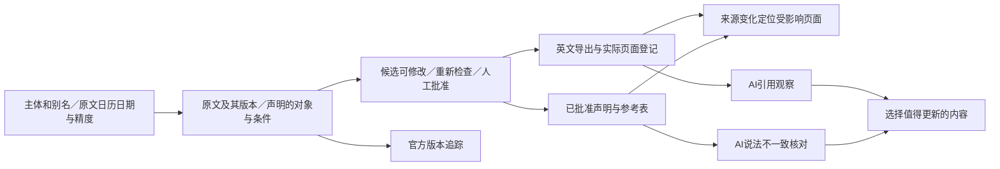

# 给 Claude：AIHOT 产品设计与统筹任务书

> 用户2026-11-05最新要求：Claude负责设计、取舍与统筹；Codex负责代码实现；同一Studio既能由WorkBuddy辅助部署，也能脱离外部Agent独立运行。本文是设计委托，不代表以下方案已经批准实施，也不启动PR-1至PR-6。

## 先读这一页，再按需取证

你的任务是交付**能让GPT照着实现的产品方案和交互原型**。先明确哪些运营工作可以停止，再决定流程和数据；关键代码只在有疑问时读取。现有PR-1至PR-6保留为候选实施顺序，不重新写一份大型PRD。

已读你的[11月5日GEO计划](https://github.com/liujing2025sem/AIHOT/blob/claude/bold-clarke-3sxamm/docs/aihot-geo-program-plan-20261105.md)和[可读性审查](https://github.com/liujing2025sem/AIHOT/blob/claude/bold-clarke-3sxamm/docs/aihot-readability-review-20261105.md)。版本追踪、声明与参考表、AI答案缺口已有方向；本轮补齐它们之间的依赖、用户动作与独立运行方式。

**当前代码依据是PR #11的8c8f76e，main仍为12e3d92，PR #11未合并。** 11月5日计划在你的claude分支，不假定main已有它。实现时由Codex处理正确基线和PR关系，不让运营解决Git依赖。

### 已知事实，避免重复侦察

- Studio已自己调用OpenCode供应的deepseek-v4.1-flash；外部Agent无需替它写稿。现有任务、原文版本、回执、预算和审稿库继续复用。
- 首篇MiP：7617字符原文、6条CAMOS方法；输入30510、输出6907 tokens，约49.46秒。回执7已received，候选响应保留，未获批准。实际费用未知。
- 你的复验：补“晶台”简称可解除16处D1阻断，不能把这些命中当16个事实错误。Codex本轮仅在内存补别名回放归档响应：45处WARN经现有聚合成为30个确认问题（26项重点、4项常规）。这是默认评审上下文的只读回放，不是目标界面实操；计数还要随编辑版重算。**原始命中数、聚合问题数、实际人工动作数分开。**
- 日期应保留原文日精度2026-10-23，不能把UTC存储时间截为October22。ViewSonic获奖新闻曾因damage一词误配海运验货，已否决；人工MiP卡不证明自动推荐有效。
- WorkBuddy加载曾由其会话持有；普通Windows启动器已经存在。Linux的CAMOS入口仍硬编码python.exe；现有worker有采集调度，但没有完整Studio选题到成稿调度。手动独立运行与无人值守是两项验收。
- 当前请求将26031字符的CAMOS方法同时放进system和user.request.methods。Codex可先去重并测同源质量/输入tokens；尚无节省比例实测。

## 六个需要你作出取舍的设计问题

每题给“推荐选择、舍弃什么、运营少做哪一步、怎样证明”。只在有实质不同的交互方向时给两个方案，并明确推荐一个。

| 设计题 | 必须回答的关键点 | 需要看到的设计产物 |
|---|---|---|
| 1. 运营每天从哪里开始 | 打开后先处理新消息、旧页变化还是未完成稿？没有增量时怎样安静结束？第一次使用与日常使用是否不同？ | 一个主工作面；从选题到导出的最短路径；待修稿不用下载JSON也能继续 |
| 2. 系统怎样判断值得做 | 同一材料何时写短讯、做解释、更新旧页、只留参考、暂缓或不写？如何展示“新在哪里、证据在哪、为什么值得处理”？ | 一张能据此决定行动的卡；处理damage误配、旧技术资料和无日期新版本的具体例子 |
| 3. 人怎样低负担地审稿 | 30个确认问题怎样组织，哪些只是证据核对，哪些需要编辑判断？改meta、改数值、改来源版本后，哪些确认失效？ | “待修→核对证据→可交付”三个真实状态；逐句修改/再检查路径；不隐藏风险、不设全选放行 |
| 4. 内容怎样积累为可维护资产 | 版本追踪、参数表、解释文怎样共用已批准材料？来源改版后怎样找到受影响页面？ | 用MiP演示“一条原厂声明→参考表和文章→一次修订”；区分厂商自述、独立验证与编辑推断 |
| 5. 谁负责持续执行 | WorkBuddy会话关闭、浏览器刷新、请求超时、任务已付费但未落稿时，系统显示什么、谁继续？ | 同一引擎的“人工触发独立运行”和“批准范围内自动产草稿”两级；后者单独启用，发布仍由人决定 |
| 6. 创意优先投入哪里 | 版本追踪、参数解释、供应商询问清单、来源变化提醒，哪项先做更能减少重复工作？ | 选一个旗舰能力；列一个放弃方向；用相同信源＋上期摘要＋同一Flash的基线评价增量 |

## 必须先理顺的依赖



- **页面登记是关键前置。** 没有实际URL与页面/稿件版本绑定，只能提示“可能有变化”，不能声称已知道哪页哪段需更新。引用观察的导入和页面归属可独立建设；参数冲突比较才依赖声明结构，不必把PR-6全部绑在PR-5之后。
- **声明文本不会自动变成参数数据。** 现有evidence是claim/quote；需决定怎样形成主体、型号、指标对象（封装/模组/整屏）、值/单位、条件、来源版本与日期。首版只做当前案例需要的字段，不建通用知识图谱；优先从现有记录带出，减少人工重新录入。
- **条件未知应如实保留。** 原文没写测试条件时可登记“未披露”，不能强迫编辑编造条件；据此限制比较和结论，而非把“能保存”当“已证实”。
- **主体归属有三个角色。** 发布者、被引用的厂商、被讨论的产品不能混为一谈；补别名解决名称识别，不让行业媒体自动成为原厂事实的证明者。

## 共同运行核心，不做两个产品

```text
WorkBuddy辅助安装的Windows电脑 ─┐
                               ├─ 同一Studio API/任务/业务库/回执/审稿 → OpenCode Flash
Linux或云端部署 ────────────────┘
```

Claude定义运营所见的状态、自动执行边界、恢复交互；Codex负责进程托管、Python适配、迁移、凭据加载、调用去重和队列接入。WorkBuddy是部署/维修入口，不应成为每篇文章的运行前提。Windows与Linux可以分别安装，**同一份业务数据只由一个选定实例负责写入**；移机用已有私有快照流程，不默认设计双向同步。

最低业务验证：在不需要WorkBuddy继续持有任务的部署方式下，人从页面完成一篇，关闭外部Agent后服务和已保存状态仍可用。连续无人值守、备份/提醒与自动草稿是后续独立里程碑，具体开关和预算沿用用户决定。

## 给你的创作空间与交付要求

先从“行动工作台”和你提出的另一种实质不同的结构中选一个：区别应在运营的决策路径，而不只是颜色。给出所选方案的短HTML或SVG原型，覆盖同一篇MiP的“待修、核对、可交付”三态；可用少量合成演示内容，但必须标注，不能伪装真实验收。展示首屏主动作、源文/稿件关系、异常提示、桌面与手机优先级；风格由你决定。

**一次输出即可，建议正文约1500–2500中文字符，加原型：**

1. 一句话产品定位、一个旗舰能力及其取舍。
2. 核心流程和依赖图；只列新增或调整的决定。
3. 三态原型及关键文案。
4. 给Codex的下一块实现任务：触发与输入、用户动作、状态/异常、沿用模块、验收样例、明确不含什么。
5. 最多3个确需用户决定的问题；已批准的Blog/英文/多方向/OpenCode Flash/人工发布不重复提问。

首篇“晶台别名＋日期出口＋重导入已有响应”的小修可独立推进，不等待全套产品设计。Claude编辑版由用户贴入并批准；本次设计委托不代替用户审批，不自动合并任何PR。

## 节省你的上下文和执行开销

- **必读仅本文**；原计划在你自己的分支，按需回看。不要重新下载完整业务库、逐个读所有历史回执或替GPT全量跑测试来完成设计。
- 看图只需[已绑证据卡](assets/operator-guide/08-manual-card-bound.png)、[待成稿任务](assets/operator-guide/09-task-ready.png)、[受阻任务](assets/operator-guide/10-first-generation-blocked.png)。设计原型不冒充已实施页面。
- 工程参考：`admin/studio.ts`（既有采编/重导入），`admin/editorial-issues.ts`（问题聚合/确认），`admin/studio-publication.ts`（出口），`providers/receipts.ts`（去重/预算），`admin/camos-methods.ts`（方法检索）；均位于`packages/backend/src/`。只在需要确定能力时读。
- Codex做实现与相称验证，再交你看关键差异和业务样例；你验产品选择及真实体验，不必重复整套侦察。新稿真相、受影响边界必须检查；不机械套每PR十条浏览器线路和任意性能倍数。遵从用户“额外防御投入不超过功能推进五分之一”的要求，不启动新的pstack/定时巡检流程。
- 开头直答、表格和图解是阅读与核对设计，不是引用保证。Google说明AI功能无额外技术要求或特殊schema；效果需观察而不能用格式验收代签：[官方说明](https://developers.google.com/search/docs/appearance/ai-features)。

**本轮角色**：用户决定业务优先级、预算、开关、合并与发布；Claude主导产品设计、方案取舍与验收；Codex负责工程拆解、编码、部署适配和反馈实测；Studio承担日常采编执行。每轮由Codex把实测差异压成下一次设计输入，避免用户充当材料搬运员。
