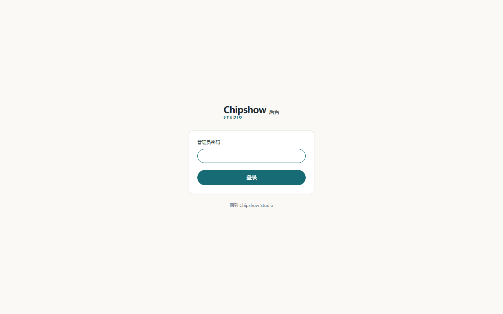
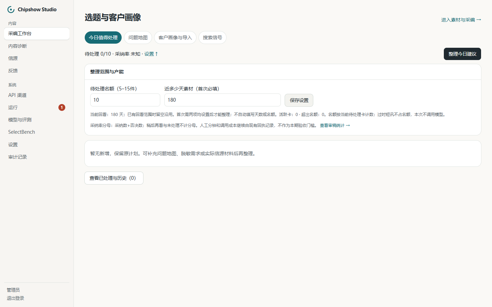
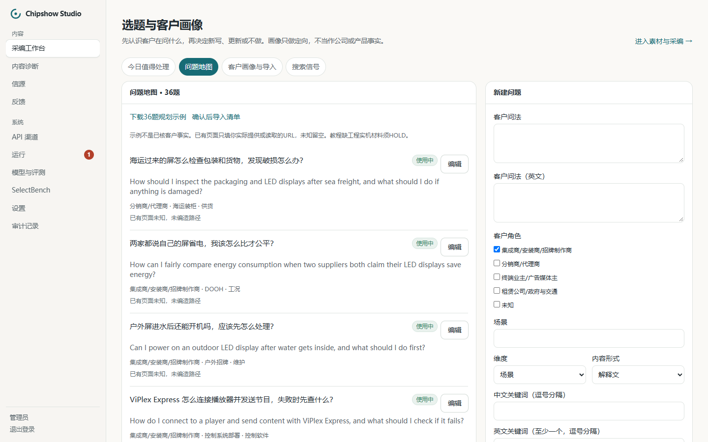
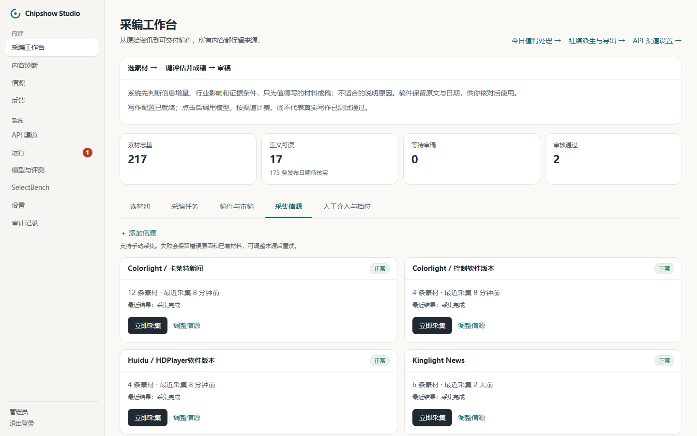
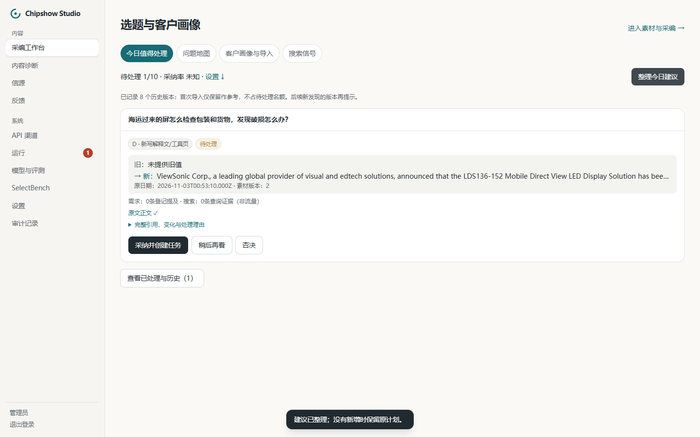

# Chipshow Studio 操作手册：R1 实操版（出文部分待完成）

本手册的登录、首次配置、36题导入、手动采集、建议检查和否决，已在 WorkBuddy 目标实例实际操作。截图均为该实例1440×900实拍。首篇尚未调用模型，成稿、批准和导出部分等待真实跑完后补齐，当前不能据此签署 R1 完成。

## 一页速查

| 要做的事 | 去哪里 | 本轮实际状态 |
|---|---|---|
| 登录 | `http://127.0.0.1:53181/admin/login` | 已验证；异机用其安装地址 |
| 选题设置 | 采编工作台 → 今日值得处理 → 设置 | **10件、180天**，已保存 |
| 查看/导入选题 | 今日值得处理 → 问题地图 | 36题已导入，不必重复 |
| 手动采集 | 采编工作台 → 采集信源 → 立即采集 | U1七个入口已执行，新入库47条 |
| 整理建议 | 今日值得处理 → 整理今日建议 | 不调用模型；本轮唯一自动卡题文不符，已否决 |
| 开始首篇 | 拟用已确认的MiP问题与现有完整资料 | 自动卡未触发，等待主动选题路径决定 |
| 查看社媒 | 采编工作台 → 社媒派生与导出 | 页面已加载；未派生、未发布 |

## 1. 登录与当前实例

本机打开 `http://127.0.0.1:53181/admin/login`，使用安装时生成的管理员密码。密码仅在安装根目录 `runtime/FIRST-RUN-CREDENTIALS.txt` 等私有配置中查看，不放进稿件或截图。

WorkBuddy 已加载 main `12e3d92`，并执行到 `0105` 迁移。后台持有任务由 WorkBuddy 管理；若网页打不开，先让部署方查看该任务与运行状态，不重复安装或清空数据。

## 2. 首次设置：10件、180天

进入“今日值得处理”，点击数字右侧的“设置”。填写“待处理名额”为 **10**，“近多少天素材”为 **180**，点击“保存设置”。本轮已保存，页面显示“当前回看：180天”。

10件表示当前可处理卡片的名额；180天是整理材料的回看范围。**新闻短讯仍遵守7天新鲜度限制**，不能把180天内的旧材料当成当天新闻。

## 3. 问题地图：本轮36题已在库

切换“问题地图”。首次导入时，点击“确认后导入清单”，选择安装源码中的 `industry/question-map.example.json`，确认弹窗。导入后标题应显示“问题地图 · 36题”。本轮已完成，无需重复导入。

每题保留中文、英文客户问法、场景、内容形式和关联来源。已有页面 URL 只填真实地址，未知留空。用户确认选题不等于已经取得客户询盘证据；页面仍保留这一说明。

## 4. 手动采集：使用采编工作台里的“采集信源”

回到“采编工作台”，切换“采集信源”，在所需信源卡上点击“立即采集”。查看返回提示和卡片上的最近结果；失败时保留原文与错误，改入口前先确认。

本轮使用这个 Studio 直接采集入口，不依赖定时 worker。侧栏通用“信源”详情页的同名按钮会把任务排队，当前 worker 未开启，不把排队当成完成采集。

本轮 U1 结果：

| 信源 | 发现 | 新增 | 当前已采集资料的最新发布时间（UTC） |
|---|---:|---:|---|
| MEAN WELL | 5 | 0 | 2026-09-28 |
| Colorlight 新闻 | 12 | 12 | 2026-10-20 |
| Colorlight 控制软件 | 4 | 4 | 未提供 |
| OAAA | 14 | 14 | 2026-10-16 |
| LEDinside | 16 | 10 | 2026-11-03 |
| NovaStar 新闻 | 3 | 3 | 未提供 |
| HDPlayer | 4 | 4 | 未提供 |

合计新增47条，素材总数从170到217。发现数不等于新增数。无日期如实保留，不能拿发现日期替换；首次导入的8个软件版本显示为历史版本，不占待处理名额。

## 5. 整理与检查建议：有原文还要看题文是否相符

点击“整理今日建议”。先看卡片的问题、变化、原日期、引用和证据清单，再决定采纳。原文正文“✓”只说明正文可读取，仍要判断它能否回答卡片上的问题。

本轮首次整理扫描212条材料，产生1张候选，未调用模型。该条引用 ViewSonic 移动LED显示屏获奖新闻。补齐正文后再次整理扫描202条，出现其新素材版本对应的卡；旧版本卡保留为失效历史。**这是同一条材料的两个版本，不是两次独立选题机会。**

新卡题目变成“海运过来的屏怎么检查包装和货物，发现破损怎么办？”，原文没有这些方法。现场检查发现该问题只命中 `damage` 一个词，并与多个不相干问题同分；当前规则的内部排序选中了它。不能将这张卡作为有效增量价值证明。

处理时点击“否决”，填写理由，再点击“记录否决”。本轮填写：

> 原文为 ViewSonic 移动 LED 显示屏获奖新闻，没有海运验货、包装检查或破损处理方法；正文完整不代表能支持这个题目，故不采纳。

否决成功后，该卡从待处理区移入历史，理由留作后续改进依据。

## 6. 当前首篇为什么还没出

MiP 问题已经在36题中，Kinglight 的 MiP 资料有完整正文，库内发布时间为 `2026-10-22T16:00:00Z`。它未满足当前新鲜新闻触发条件，当前也没有真实询盘或搜索信号替它触发解释文卡。因此还没有可采纳的MiP卡。

用户正在决定是否增加“运营主动选题”入口：从已经确认的问题创建清楚标注为人工选题的卡，绑定真实材料，继续正常采编。这个入口目前**尚未实现**。不制造询盘、修改原日期或手写数据库推荐记录来凑卡。

首篇的实际成稿、中文审稿、英文批准和MD/HTML/JSON导出，将在这一决定落地并真实执行后补入本手册。当前未发生本轮Flash成稿调用，尚无本轮token、费用和获批稿件可报告。

## 7. 常见情况

| 看到什么 | 怎么处理 |
|---|---|
| “整理今日建议”不可点击 | 打开“设置”，检查名额和回看天数是否都已保存 |
| 首次导入软件版本却没有版本卡 | 查看历史版本提示；后续真正新增版本才提示，不把旧归档当更新 |
| 原文正文为“✗” | 先到素材池补齐正文，再刷新建议；素材版本变化后核对新卡 |
| 原文正文为“✓”，但题目不相关 | 不直接采纳，记录具体否决理由 |
| 素材池有旧技术资料但没有卡 | 当前规则确实可能如此；不要靠改日期或造需求解决 |
| “待处理名额已满” | 处理已有卡片；确需改名额时由运营决定 |
| 想发布到官网 | 先完成审稿与批准；本轮WordPress发布仍由用户决定 |

本轮画像导入冒烟使用2条明确合成数据，导入后已撤回，登记提及数恢复为0；没有用合成数据为真实首篇凑需求。
